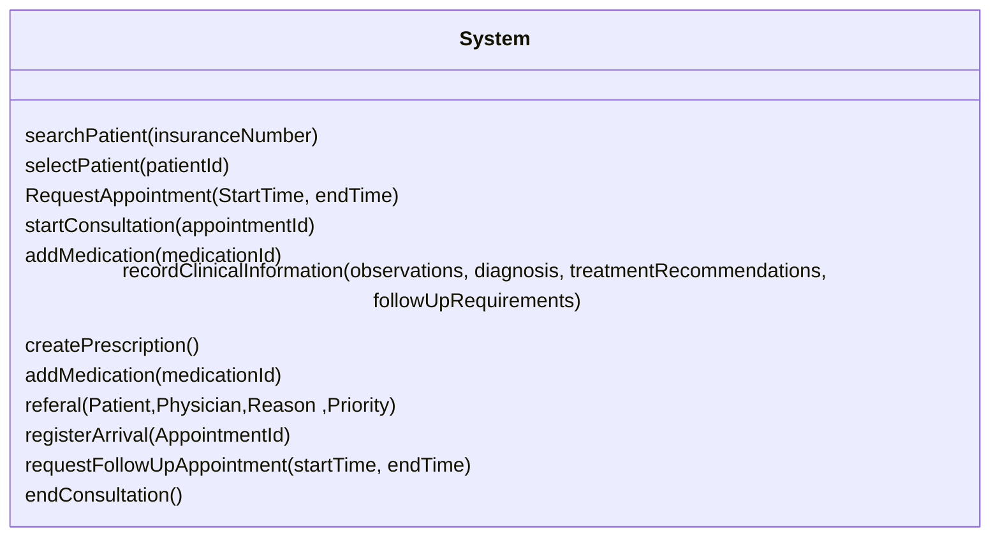

> Note Preview can be done through the Github page when accessing the `docs\System_operations_contracts\System_operations.md` file OR could be read through VSCode using a UML translator and the Markdown in Preview Mode. 

# Operation Contracts

**Version 1.1.0**
Based on UML Domain Model v1.1.0 and the SSDs for **1. Book Appointment**, **2. Create Referral**, **4. Register Patient Arrival**, and **5. Conduct Consultation**.

---

## 1. Book Appointment

### System Operation 1: RequestAppointment(startTime, endTime)

**Preconditions**
- A `Patient` `p` exists in the system.
- A `HealthcareProfessional` `hp` exists and has an available `Schedule` for the requested time interval.
- No other `Appointment` assigned to `hp` overlaps `startTime`–`endTime`.

**Postconditions**

| Postcondition | Type |
|---|---|
| An `AppointmentRequest` `ar` was created. | Instance creation |
| `ar.requestId` was set to a new unique value. | Attribute modification |
| `ar.requestedAt` became the current date and time. | Attribute modification |
| `ar.status` became `"Approved"`. | Attribute modification |
| `ar` was associated with `p`. | Association formed |
| An `Appointment` `a` was created. | Instance creation |
| `a.appointmentId` was set to a new unique value. | Attribute modification |
| `a.startTime` and `a.endTime` became the given values. | Attribute modification |
| `a.status` became `"Confirmed"`. | Attribute modification |
| `a` was associated with `ar`. | Association formed |
| `a` was associated with `p`. | Association formed |
| `a` was associated with `hp`. | Association formed |

---

## 2. Create Referral

### System Operation 1: referral(patient, physician, reason, priority)

**Preconditions**
- The healthcare professional creating the referral is logged in.
- A `Patient` `p` with the provided patient information exists.
- A `HealthcareProfessional` `hp` with the provided physician information exists.
- `reason` and `priority` are provided.

**Postconditions**

| Postcondition | Type |
|---|---|
| A `Referral` `r` was created. | Instance creation |
| `r.referralId` was set to a new unique value. | Attribute modification |
| `r.clinicalReason` and `r.priority` became the given values. | Attribute modification |
| `r.status` became `"Created"`. | Attribute modification |
| `r` was associated with `p`. | Association formed |
| `r` was associated with `hp`. | Association formed |

---

## 3. Register Patient Arrival

### System Operation 1: searchPatient(insuranceNumber)

**Preconditions**
- The administrative staff member is logged in.

**Postconditions**
- None (query operation).

### System Operation 2: selectPatient(patientId)

**Preconditions**
- A `Patient` `p` with `p.patientId = patientId` exists.

**Postconditions**
- None (query operation).

### System Operation 3: registerArrival(appointmentId)

**Preconditions**
- An `Appointment` `a` with `a.appointmentId = appointmentId` exists.
- `a` is associated with the selected `Patient` `p`.
- `a.startTime` is today.
- `a.status` is `"Confirmed"` or `"Rescheduled"`.

**Postconditions**

| Postcondition | Type |
|---|---|
| `a.status` became `"Arrived"`. | Attribute modification |

---

## 4. Conduct Consultation

### System Operation 1: startConsultation(appointmentId)

**Preconditions**
- The healthcare professional `hp` is logged in.
- An `Appointment` `a` with `a.appointmentId = appointmentId` exists.
- `a` is associated with `hp`.
- `a.status = "Arrived"`.
- `a` is not yet associated with a `Consultation`.

**Postconditions**

| Postcondition | Type |
|---|---|
| A `Consultation` `c` was created. | Instance creation |
| `c.consultationId` was set to a new unique value. | Attribute modification |
| `c.consultationDate` became the current date and time. | Attribute modification |
| `c` was associated with `a`. | Association formed |
| `c` was associated with `hp`. | Association formed |
| `c` was associated with the `Patient` `p` of `a`. | Association formed |

### System Operation 2: recordClinicalInformation(observations, diagnosis, treatmentRecommendations, followUpRequirements)

**Preconditions**
- A `Consultation` `c` is in progress.
- `c` is not yet associated with a `ClinicalRecord`.

**Postconditions**

| Postcondition | Type |
|---|---|
| A `ClinicalRecord` `cr` was created. | Instance creation |
| `cr.clinicalRecordId` was set to a new unique value. | Attribute modification |
| `cr.observations`, `cr.diagnosis`, `cr.treatmentRecommendations` and `cr.followUpRequirements` became the given values. | Attribute modification |
| `cr` was associated with `c`. | Association formed |

### System Operation 3: createPrescription()

**Preconditions**
- A `Consultation` `c` is in progress, conducted by `hp` for `Patient` `p`.

**Postconditions**

| Postcondition | Type |
|---|---|
| A `Prescription` `pr` was created. | Instance creation |
| `pr.prescriptionId` was set to a new unique value. | Attribute modification |
| `pr.issueDate` became the current date. | Attribute modification |
| `pr` was associated with `c`. | Association formed |
| `pr` was associated with `hp`. | Association formed |
| `pr` was associated with `p`. | Association formed |

### System Operation 4: addMedication(medicationId)

**Preconditions**
- A `Prescription` `pr` is in progress.
- A `Medication` `m` with `m.medicationId = medicationId` exists.
- `pr` is not already associated with `m`.

**Postconditions**

| Postcondition | Type |
|---|---|
| `pr` was associated with `m`. | Association formed |

### System Operation 5: requestFollowUpAppointment(startTime, endTime)

**Preconditions**
- A `Consultation` `c` is in progress, conducted by `hp` for `Patient` `p`.
- `hp` has a `Schedule` `s` where `s.startTime ≤ startTime` and `endTime ≤ s.endTime`.
- `hp` has no other `Appointment` that overlaps `startTime`–`endTime`.

**Postconditions**

| Postcondition | Type |
|---|---|
| An `AppointmentRequest` `ar` was created. | Instance creation |
| `ar.requestId` was set to a new unique value. | Attribute modification |
| `ar.requestedAt` became the current date and time. | Attribute modification |
| `ar.status` became `"Approved"`. | Attribute modification |
| `ar` was associated with `p`. | Association formed |
| An `Appointment` `fa` was created. | Instance creation |
| `fa.appointmentId` was set to a new unique value. | Attribute modification |
| `fa.startTime` and `fa.endTime` became the given values. | Attribute modification |
| `fa.status` became `"Confirmed"`. | Attribute modification |
| `fa` was associated with `ar`. | Association formed |
| `fa` was associated with `p`. | Association formed |
| `fa` was associated with `hp`. | Association formed |

### System Operation 6: endConsultation()

**Preconditions**
- A `Consultation` `c` is in progress, created from `Appointment` `a`.
- `c` is associated with a `ClinicalRecord`.
- Every `Prescription` of `c` is associated with at least one `Medication`.

**Postconditions**

| Postcondition | Type |
|---|---|
| `a.status` became `"Completed"`. | Attribute modification |