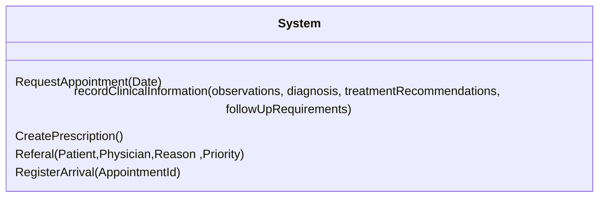

> Note Preview can be done through the Github page when accessing the `docs\System_operations_contracts\System_operations.md` file OR could be read through VSCode using a UML translator and the Markdown in Preview Mode. 

