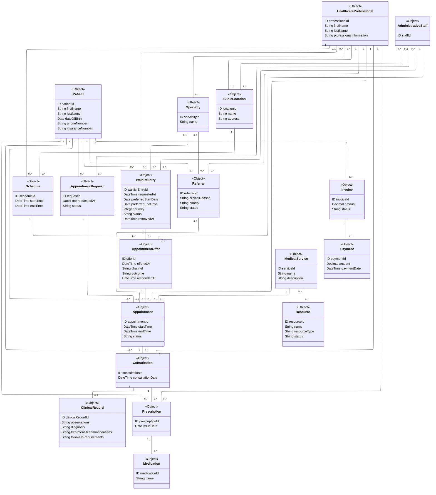
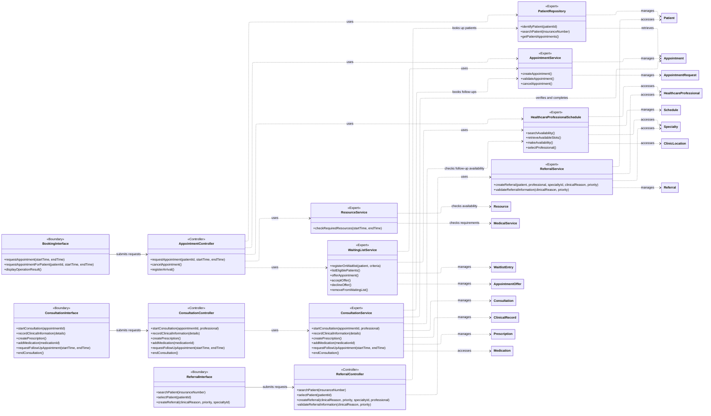

# Partial UML Class Diagram

Both views describe the same partial design. The first shows the domain classes and their associations. The second shows how the interfaces, controllers, and services use those classes. Showing these relationships in two views makes the connectors easier to follow.

## Domain classes and associations

## Design classes and dependencies

Consultation follow-ups use an approved `AppointmentRequest` linked to a confirmed `Appointment`.
Resource reservation design is scheduled for Iteration III.

