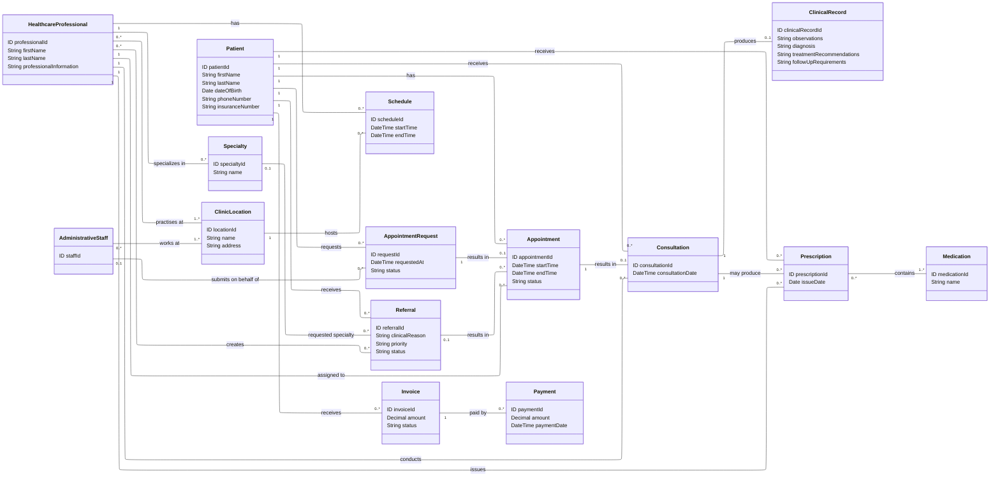

# Medical Appointment Tracking System UML Domain Model
> Note Preview can be done through the Github page when accessing the `docs/UML_Domain_model.md` file OR could be read through VSCode using a UML translator and the Markdown in Preview Mode. 

## Iteration II Domain Model

**Version 2.0.0 - Iteration II**

```mermaid
---
config:
  layout: elk
  class:
    hideEmptyMembersBox: false
    nodeSpacing: 110
    rankSpacing: 150
    diagramPadding: 50
    padding: 15
---

classDiagram
direction LR

    class Patient {
        ID patientId
        String firstName
        String lastName
        Date dateOfBirth
        String phoneNumber
        String insuranceNumber
    }

    class HealthcareProfessional {
        ID professionalId
        String firstName
        String lastName
        String professionalInformation
    }

    class AdministrativeStaff {
        ID staffId
    }

    class Specialty {
        ID specialtyId
        String name
    }

    class Schedule {
        ID scheduleId
        DateTime startTime
        DateTime endTime
    }

    class ClinicLocation {
        ID locationId
        String name
        String address
    }

    class AppointmentRequest {
        ID requestId
        DateTime requestedAt
        String status
    }

    class Appointment {
        ID appointmentId
        DateTime startTime
        DateTime endTime
        String status
    }

    class WaitlistEntry {
        ID waitlistEntryId
        DateTime requestedAt
        Date preferredStartDate
        Date preferredEndDate
        Integer priority
        String status
        DateTime removedAt
    }

    class AppointmentOffer {
        ID offerId
        DateTime offeredAt
        String channel
        String outcome
        DateTime respondedAt
    }

    class MedicalService {
        ID serviceId
        String name
        String description
    }

    class Resource {
        ID resourceId
        String name
        String resourceType
        String status
    }

    class ResourceRequirement {
        ID requirementId
        Integer quantity
    }

    class ResourceAllocation {
        ID allocationId
        DateTime allocatedAt
        String status
    }

    class Consultation {
        ID consultationId
        DateTime consultationDate
    }

    class ClinicalRecord {
        ID clinicalRecordId
        String observations
        String diagnosis
        String treatmentRecommendations
        String followUpRequirements
    }

    class Referral {
        ID referralId
        String clinicalReason
        String priority
        String status
    }

    class Prescription {
        ID prescriptionId
        Date issueDate
    }

    class Medication {
        ID medicationId
        String name
    }

    class Invoice {
        ID invoiceId
        Decimal amount
        String status
    }

    class Payment {
        ID paymentId
        Decimal amount
        DateTime paymentDate
    }


    %% =========================
    %% Healthcare Structure
    %% =========================

    HealthcareProfessional "0..*" -- "0..*" Specialty : specializes in

    HealthcareProfessional "1" -- "0..*" Schedule : has

    HealthcareProfessional "0..*" -- "1..*" ClinicLocation : practises at

    ClinicLocation "1" -- "0..*" Schedule : hosts

    AdministrativeStaff "0..*" -- "1..*" ClinicLocation : works at


    %% =========================
    %% Appointment Requests
    %% =========================

    Patient "1" -- "0..*" AppointmentRequest : requests

    AdministrativeStaff "0..1" -- "0..*" AppointmentRequest : submits on behalf of

    AppointmentRequest "1" -- "0..1" Appointment : results in

    AppointmentRequest "1" -- "0..1" WaitlistEntry : creates when unavailable


    %% =========================
    %% Appointments
    %% =========================

    Patient "1" -- "0..*" Appointment : has

    HealthcareProfessional "1" -- "0..*" Appointment : assigned to

    MedicalService "1" -- "0..*" Appointment : scheduled service


    %% =========================
    %% Waiting Lists
    %% =========================

    Patient "1" -- "0..*" WaitlistEntry : joins

    HealthcareProfessional "0..1" -- "0..*" WaitlistEntry : preferred professional

    Specialty "0..1" -- "0..*" WaitlistEntry : preferred specialty

    AdministrativeStaff "0..*" -- "0..*" WaitlistEntry : manages priority and removal

    WaitlistEntry "1" -- "0..*" AppointmentOffer : receives

    Schedule "1" -- "0..*" AppointmentOffer : offered slot

    AdministrativeStaff "1" -- "0..*" AppointmentOffer : records phone offer

    AppointmentOffer "0..1" -- "0..1" Appointment : accepted offer creates


    %% =========================
    %% Resource Allocation
    %% =========================

    MedicalService "1" -- "0..*" ResourceRequirement : defines

    Resource "1" -- "0..*" ResourceRequirement : satisfies

    Appointment "1" -- "0..*" ResourceAllocation : has

    Resource "1" -- "0..*" ResourceAllocation : reserves


    %% =========================
    %% Consultations
    %% =========================

    Appointment "1" -- "0..1" Consultation : results in

    HealthcareProfessional "1" -- "0..*" Consultation : conducts

    Patient "1" -- "0..*" Consultation : receives

    Consultation "1" -- "0..1" ClinicalRecord : produces


    %% =========================
    %% Referrals
    %% =========================

    Patient "1" -- "0..*" Referral : receives

    HealthcareProfessional "1" -- "0..*" Referral : creates

    Specialty "0..1" -- "0..*" Referral : requested specialty

    Referral "0..1" -- "0..*" Appointment : results in


    %% =========================
    %% Prescriptions
    %% =========================

    Consultation "1" -- "0..*" Prescription : may produce

    HealthcareProfessional "1" -- "0..*" Prescription : issues

    Patient "1" -- "0..*" Prescription : receives

    Prescription "0..*" -- "1..*" Medication : contains


    %% =========================
    %% Billing
    %% =========================

    Patient "1" -- "0..*" Invoice : receives

    Invoice "1" -- "0..*" Payment : paid by
```

---

## Iteration I Domain Model

**Version 1.1.0**

