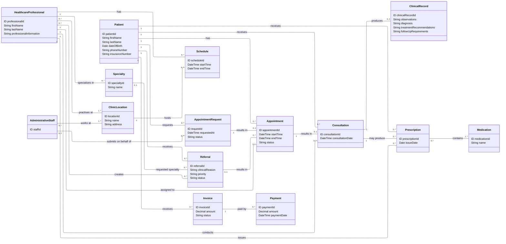

# Medical Appointment Tracking System UML Domain Model
> Note Preview can be done through the Github page when accessing the `docs/UML_Domain_model.md` file OR could be read through VSCode using a UML translator and the Markdown in Preview Mode. 

**Version 1.1.0**

