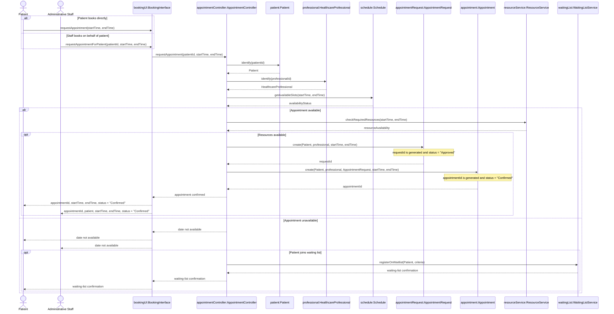

# UML Interaction Diagram: Book Appointment

This design-level sequence diagram realizes the **RequestAppointment** system operation defined by the SSD `1_Book_Appointment_SSD` and the operation contracts. `BookingInterface` is the boundary object and `AppointmentController` coordinates the interaction. All remaining participants are concepts from the UML domain model (v2.0.0).

## Traceability

| System operation | Design realization | Domain-model support |
|---|---|---|
| `RequestAppointment(startTime, endTime)` | The controller identifies the patient and healthcare professional, checks the professional's schedule, and creates an approved appointment request and confirmed appointment when the slot is available. | `Patient` requests `AppointmentRequest`; `HealthcareProfessional` is assigned to `Appointment`; `Schedule` provides availability; `AppointmentRequest` results in `Appointment`. |
| `requestAppointmentForPatient(patientId, startTime, endTime)` | Administrative Staff submits the booking through the interface on behalf of the patient. | `AdministrativeStaff` may submit an `AppointmentRequest` on behalf of a `Patient`. |

## Operation Contract Realized: `RequestAppointment(startTime, endTime)`

| Postcondition | Type | Realized by |
|---|---|---|
| An `AppointmentRequest` `ar` was created. | Instance creation | `create(Patient, professional, startTime, endTime)` |
| `ar.requestId` was set to a new unique value. | Attribute modification | `AppointmentRequest` constructor |
| `ar.requestedAt` became the current date and time. | Attribute modification | `AppointmentRequest` constructor |
| `ar.status` became `"Approved"`. | Attribute modification | `AppointmentRequest` constructor |
| `ar` was associated with `Patient`. | Association formed | `create(Patient, professional, startTime, endTime)` |
| An `Appointment` `a` was created. | Instance creation | `create(Patient, professional, AppointmentRequest, startTime, endTime)` |
| `a.appointmentId` was set to a new unique value. | Attribute modification | `Appointment` constructor |
| `a.startTime` and `a.endTime` became the given values. | Attribute modification | `Appointment` constructor |
| `a.status` became `"Confirmed"`. | Attribute modification | `Appointment` constructor |
| `a` was associated with `ar`. | Association formed | `AppointmentRequest` parameter of `create` |
| `a` was associated with `Patient`. | Association formed | `Patient` parameter of `create` |
| `a` was associated with `HealthcareProfessional`. | Association formed | `HealthcareProfessional` parameter of `create` |

## Scope Boundary

Resource availability and waiting-list registration are shown only as optional booking alternatives. The base appointment operation creates the appointment only when the professional, time slot, and required resources are available. Waiting-list and resource-allocation details are not additional postconditions of `RequestAppointment`.
