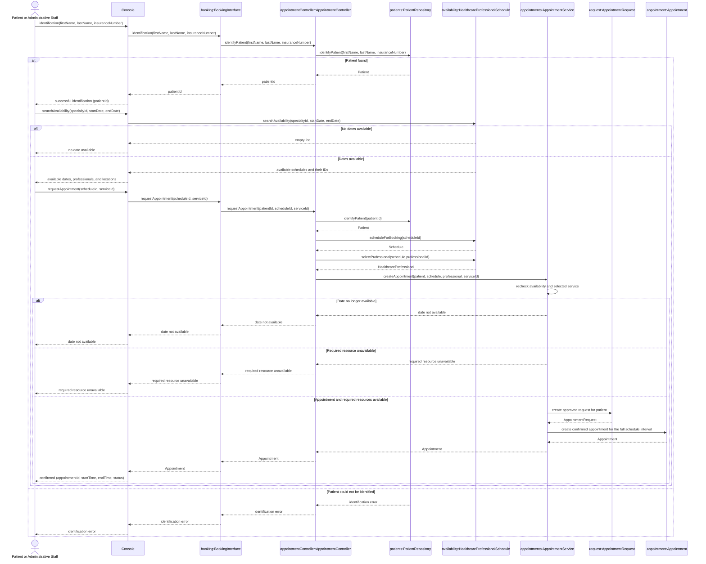

# UML Interaction Diagram: Book Appointment

The [booking SSD](../System_Sequence_diagram/1_Book_Appointment_SSD.md) shows the actor's requests and responses. This interaction shows how the PoC identifies a patient, searches availability, and confirms an appointment for the entire selected schedule.

## Traceability

| System operation | Design realization | Domain-model support |
|---|---|---|
| `identification(firstName, lastName, insuranceNumber)` | `BookingInterface` keeps the ID returned by `PatientRepository` for the next booking request. | `Patient` holds the lookup fields and its unique `patientId`. |
| `searchAvailability(specialtyId, startDate, endDate)` | `HealthcareProfessionalSchedule` returns bookable schedules. Direct search can also filter by professional. | A `HealthcareProfessional` has specialties and schedules. Each schedule is hosted at a clinic location. |
| `requestAppointment(scheduleId, serviceId)` | `AppointmentController` resolves the patient, schedule, and professional. `AppointmentService` rechecks the interval and selects the medical service by ID. | `AppointmentRequest` belongs to a patient and results in an `Appointment` for the patient, professional, and medical service. |

The [booking operation contract](../System_operations_contracts/Contracts_System_Operations.md#system-operation-1-requestappointmentscheduleid-serviceid) defines the approved request and confirmed appointment. The [join-waitlist SSD](../System_Sequence_diagram/8_Join_Waitlist_SSD.md) documents the wider waitlist flow. The PoC reports unavailable slots and uses a demo service with no additional resource requirements.
