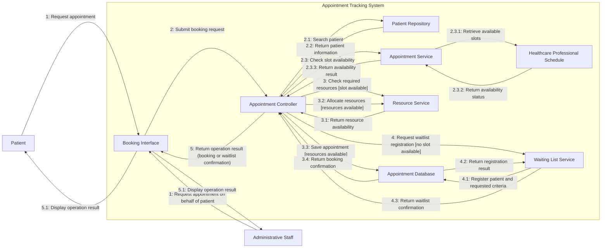

> Note Preview can be done through the Github page when accessing the file OR could be read through VSCode using a UML translator and the Markdown in Preview Mode. 

2.x: Common initial interactions (patient search and availability checks).

3.x: Successful booking flow.

4.x: Waiting-list registration flow.

5.x: Communicate the final result.