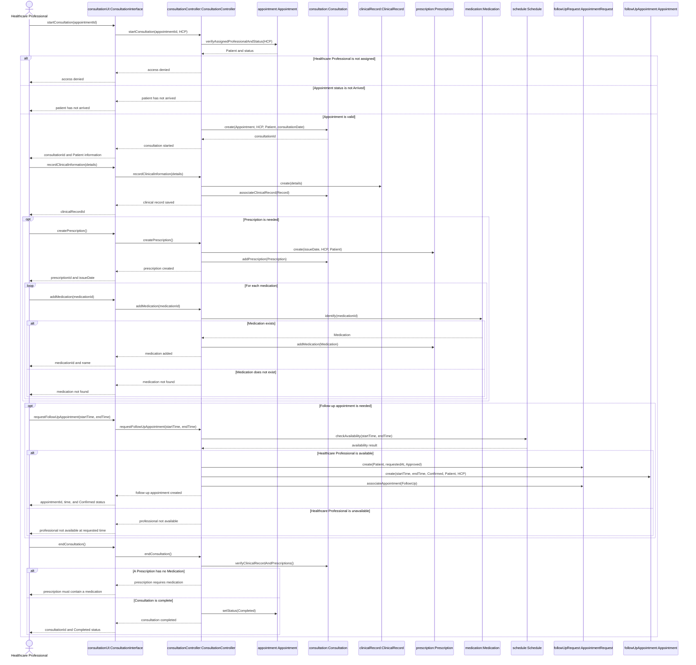

# UML Interaction Diagram: Conduct Consultation

This design-level sequence diagram realizes the **Conduct Consultation** system operations defined by the existing SSD and operation contracts. `ConsultationInterface` is the boundary object and `ConsultationController` coordinates the interaction. All remaining participants are concepts from the UML domain model.

## Traceability

| System operation | Design realization | Domain-model support |
|---|---|---|
| `startConsultation(appointmentId)` | The controller verifies the assigned professional and `Arrived` status before creating the consultation. | `Appointment` results in `Consultation`; `HealthcareProfessional` conducts it; `Patient` receives it. |
| `recordClinicalInformation(...)` | A clinical record is created and associated with the active consultation. | `Consultation` produces zero or one `ClinicalRecord`. |
| `createPrescription()` | A prescription is created for the active consultation, professional, and patient. | `Consultation` may produce `Prescription`; the professional issues it and the patient receives it. |
| `addMedication(medicationId)` | The medication is identified before it is associated with the prescription. | `Prescription` contains one or more `Medication` objects. |
| `requestFollowUpAppointment(startTime, endTime)` | The professional's schedule is checked before an approved request and confirmed appointment are created. | `HealthcareProfessional` has `Schedule`; `AppointmentRequest` may result in `Appointment`. |
| `endConsultation()` | The consultation record and prescriptions are validated before the appointment becomes `Completed`. | `Appointment.status`, `Consultation`, `ClinicalRecord`, `Prescription`, and `Medication` support the contract postconditions. |

## Scope Boundary

Waiting-list offers and resource allocation are not added to this interaction. The Iteration II requirements introduce those concerns for appointment availability and booking, while the existing Conduct Consultation SSD and operation contracts do not invoke them.
