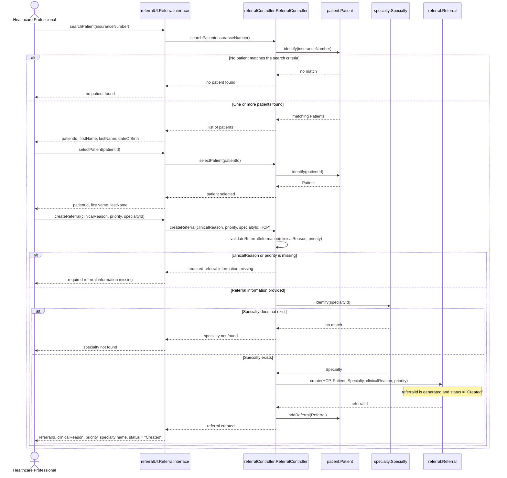

# UML Interaction Diagram: Create Referral

This design-level sequence diagram realizes the **Create Referral** system operations defined by the SSD `4_Create_Referral_SSD` and the operation contracts. `ReferralInterface` is the boundary object and `ReferralController` coordinates the interaction. All remaining participants are concepts from the UML domain model (v2.0.0).

## Traceability

| System operation | Design realization | Domain-model support |
|---|---|---|
| `searchPatient(insuranceNumber)` | The controller identifies the patients whose insurance number matches the search criteria. | `Patient` holds `insuranceNumber`, `firstName`, `lastName`, and `dateOfBirth`. |
| `selectPatient(patientId)` | The controller identifies the selected patient and keeps it for the next operation. | `Patient` is uniquely identified by `patientId`. |
| `createReferral(clinicalReason, priority, specialtyId)` | The controller validates the referral information and identifies the requested specialty before the referral is created for the patient, the professional, and the specialty. | `HealthcareProfessional` creates `Referral`; `Patient` receives it; `Specialty` is the requested specialty. `Referral` holds `referralId`, `clinicalReason`, `priority`, and `status`. |

## Operation Contract Realized: `createReferral(clinicalReason, priority, specialtyId)`

| Postcondition | Type | Realized by |
|---|---|---|
| A `Referral` `r` was created. | Instance creation | `create(HCP, Patient, Specialty, clinicalReason, priority)` |
| `r.referralId` was set to a new unique value. | Attribute modification | `Referral` constructor |
| `r.clinicalReason` and `r.priority` became the given values. | Attribute modification | `Referral` constructor |
| `r.status` became `"Created"`. | Attribute modification | `Referral` constructor |
| `r` was associated with the `HealthcareProfessional`. | Association formed | `HCP` parameter of `create` |
| `r` was associated with the `Patient`. | Association formed | `create` and `addReferral(Referral)` |
| `r` was associated with the `Specialty`, based on `specialtyId` match. | Association formed | `Specialty` parameter of `create` |

## Scope Boundary

Waiting-list offers and resource allocation are not added to this interaction. The Iteration II requirements introduce those concerns for appointment availability and booking, while the Create Referral SSD and operation contracts do not invoke them. A referral to a specific requested professional is also not shown, because the domain model only associates `Referral` with a requested `Specialty`.
