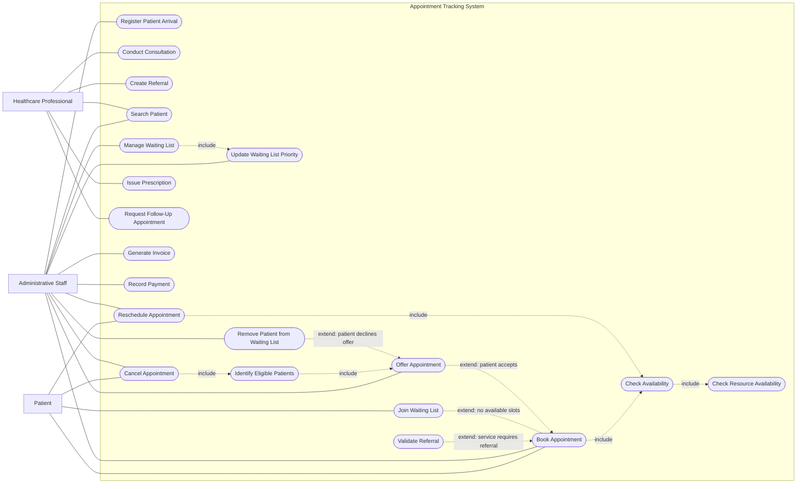

# Appointment Tracking System — Use Case Model

## Abstract

The use case model for the **Appointment Tracking System** identifies the primary actors who interact with the system and the goals they need to accomplish. It describes the system's required functional behaviour from the users' perspective, without specifying interface design or technical implementation details.

The model groups the system's functionality into **critical** and **non-critical** use cases. Critical use cases represent the core appointment and clinical workflow that the system must support. Non-critical use cases provide supporting administrative, financial, and follow-up functions that improve the completeness of the overall service.

## Actors

### Patient

The **Patient** uses the system to request and manage appointments. A patient may:

- Book an appointment.
- Reschedule an existing appointment.
- Cancel an appointment.
- Join a waiting list when no suitable appointment slot is available.

### Administrative Staff

**Administrative Staff** support patients and manage the clinic's operational workflow. They may:

- Book appointments on behalf of patients.
- Register a patient's arrival.
- Search for a patient record.
- Reschedule or cancel appointments.
- Offer appointments to patients on a waiting list.
- Manage and prioritise waiting-list entries.
- Remove a patient from a waiting list when appropriate.
- Generate invoices.
- Record payments.

### Healthcare Professional

The **Healthcare Professional** uses the system to carry out clinical activities associated with an appointment. They may:

- Conduct a consultation.
- Create a referral.
- Search for a patient record.
- Issue a prescription.
- Request a follow-up appointment.

## Critical Use Cases

The following use cases are critical because they represent the central appointment and healthcare-service workflow:

### Book Appointment

A Patient or member of Administrative Staff requests an appointment for a suitable service, date, and time. The system checks availability before the appointment can be confirmed.

### Register Patient Arrival

Administrative Staff record that a patient has arrived for a scheduled appointment. This enables the clinic to track the patient's status and prepare for the consultation.

### Conduct Consultation

A Healthcare Professional conducts and records the consultation associated with the patient's appointment.

### Create Referral

A Healthcare Professional creates a referral when the patient requires another service, specialist, or provider.

### Fully Dressed Critical Use-Case Specifications

The following three critical use cases are documented using a fully dressed format. Each specification contains a main success scenario and at least one failure extension. Corresponding happy-path and failure-path system sequence diagrams should reflect the interactions described in these scenarios.

- [Book Appointment](./Critical_Use_Case/Use_Case_Book_Appointment.md)
- [Create Referral](./Critical_Use_Case/Use_Case_Create_Referral.md)
- [Register Patient Arrival](./Critical_Use_Case/Use_Case_Register_Patient_Arrival.md)

## Non-Critical Use Cases

The following use cases support the main workflow but are not essential to every appointment:

### Search Patient

Administrative Staff and Healthcare Professionals locate an existing patient record so that they can perform other authorised tasks.

### Reschedule Appointment

A Patient or member of Administrative Staff changes an existing appointment to another available date or time. The system checks availability before the revised appointment is confirmed.

### Cancel Appointment

A Patient or member of Administrative Staff cancels an existing appointment, making the reserved time available again.

### Join Waiting List

A Patient requests to be added to the waiting list when no suitable appointment slot is available. The system stores the request and later identifies the patient as a candidate when a slot becomes available.

### Offer Appointment

Administrative Staff offer available appointments to eligible patients identified from the waiting list. If the patient accepts, the booking process continues using the standard appointment flow.

### Manage Waiting List

Administrative Staff review and maintain waiting-list entries, including tracking patient availability, service requirements, and contact status.

### Update Waiting List Priority

Administrative Staff adjust the priority of patients on the waiting list according to urgency, service type, eligibility, or scheduling requirements.

### Identify Eligible Patients

The system identifies patients on the waiting list who are eligible for an appointment based on current availability, service requirements, and booking constraints.

### Remove Patient from Waiting List

Administrative Staff remove a patient from the waiting list when the patient declines an offer, is no longer eligible, or no longer requires the service.

### Issue Prescription

A Healthcare Professional records or issues a prescription following a consultation when medication is required.

### Request Follow-Up Appointment

A Healthcare Professional requests a future appointment when the patient requires continued care or further assessment.

### Generate Invoice

Administrative Staff generate an invoice for applicable services provided to the patient.

### Record Payment

Administrative Staff record a payment made against an invoice or charge.

## Use Case Relationships

### `<<include>>` — Check Availability

The **Book Appointment** and **Reschedule Appointment** use cases both include **Check Availability**. This relationship is represented with `<<include>>` because checking availability is a required, reusable part of both workflows. An appointment cannot be booked or rescheduled successfully unless the requested date and time are available.

- **Book Appointment** `<<include>>` **Check Availability**
- **Reschedule Appointment** `<<include>>` **Check Availability**

### `<<include>>` — Check Resource Availability

The **Check Availability** use case includes **Check Resource Availability** because a valid booking also depends on whether the required staff, room, equipment, or service capacity is available.

- **Check Availability** `<<include>>` **Check Resource Availability**

### `<<extend>>` — Waiting List

The **Join Waiting List** use case extends **Book Appointment** when no suitable appointment slots are available. This is represented with `<<extend>>` because the waiting-list flow is only triggered as a fallback when the standard booking route cannot be completed.

- **Join Waiting List** `<<extend>>` **Book Appointment**
- **Extension condition:** No suitable slot is currently available.

### `<<extend>>` — Validate Referral
The **Validate Referral** use case extends **Book Appointment** when the requested service requires a referral. This is represented with `<<extend>>` because referral validation is conditional rather than part of every booking. If the selected service does not require a referral, the booking process continues without this additional behaviour.

- **Validate Referral** `<<extend>>` **Book Appointment**
- **Extension condition:** The requested service requires a referral.

---
> View inside of github and select Code to view the non-converted version or Access VSCode to view the mermaid text for the Use Case Model

## Flow Chart Mermaid Code:

