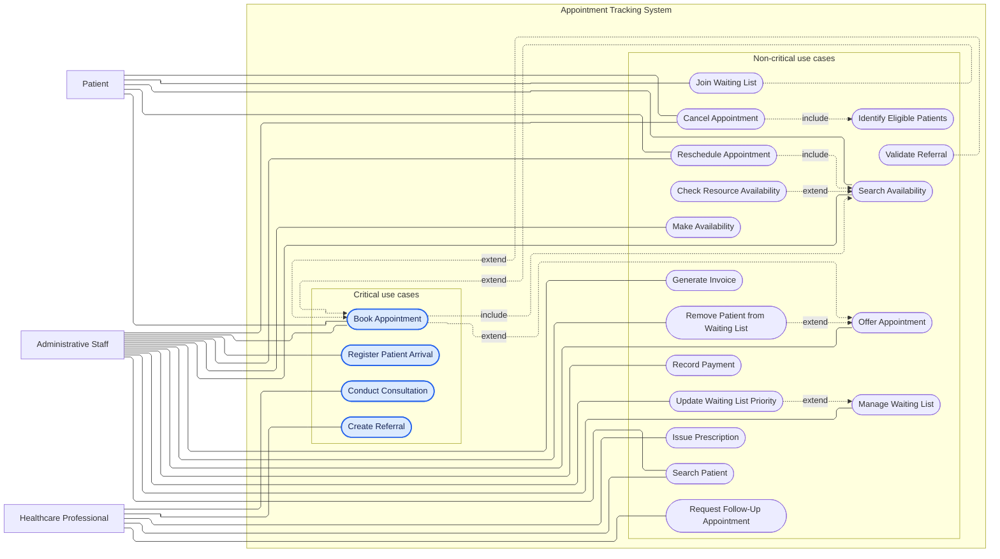

# Appointment Tracking System — Use Case Model

## Use-case diagram

The four blue use cases are critical. Solid lines connect actors to use cases. Dashed arrows show use-case relationships, with the conditions listed below.

## Critical use cases

| Use case | Actor | Outcome |
| --- | --- | --- |
| Book Appointment | Patient, Administrative Staff | The system rechecks the selected slot before confirming the appointment. Staff can book on behalf of a patient at the clinic or over the phone. When the service requires predefined resources, the system checks their availability and allocates them to the confirmed appointment. |
| Register Patient Arrival | Administrative Staff | Staff record that a patient has arrived for a scheduled appointment. |
| Conduct Consultation | Healthcare Professional | The professional conducts and records the consultation associated with the appointment. |
| Create Referral | Healthcare Professional | The professional creates a referral so the patient can receive another service or see an appropriate specialist or provider. |

The fully dressed specifications cover the main success scenarios and their extensions.

- [Book Appointment](./Critical_Use_Case/Use_Case_Book_Appointment.md)
- [Register Patient Arrival](./Critical_Use_Case/Use_Case_Register_Patient_Arrival.md)
- [Create Referral](./Critical_Use_Case/Use_Case_Create_Referral.md)

## Non-critical use cases

### Appointments and availability

| Use case | Initiated by | Outcome |
| --- | --- | --- |
| Search Availability | Patient, Administrative Staff | View available slots for a professional or specialty within a date range. Booking and rescheduling also use this search. |
| Make Availability | Administrative Staff | Create availability for a selected professional by choosing a date range, a recurrence pattern such as selected weekdays or monthly, and start and end times. |
| Reschedule Appointment | Patient, Administrative Staff | Move an appointment after the system verifies that the selected time is available. |
| Cancel Appointment | Patient, Administrative Staff | Cancel the appointment, free its time slot, and trigger a check for eligible patients on the waiting list. |
| Check Resource Availability | System | Check whether the required predefined examination rooms, equipment, or supporting roles are available for the selected medical service. Human resources are represented as roles. |
| Validate Referral | System | Verify the referral when the requested service requires one. |

### Waiting list

| Use case | Initiated by | Outcome |
| --- | --- | --- |
| Join Waiting List | Patient | Request placement when no suitable slot is available, using a professional, specialty, or date range as criteria. |
| Identify Eligible Patients | System | When an appointment is cancelled, find waitlisted patients who match the freed slot and present them in priority order. |
| Offer Appointment | Administrative Staff | Call an eligible patient to offer the slot based on waitlist priority and record the response. If the patient accepts, continue booking. |
| Manage Waiting List | Administrative Staff | Review waitlist entries, patient criteria, and contact status. |
| Update Waiting List Priority | Administrative Staff | Change the priority of a waitlist entry. |
| Remove Patient from Waiting List | Administrative Staff | Optionally remove a patient after they decline an offer. |

### Patient records, clinical follow-up, and billing

| Use case | Actor | Outcome |
| --- | --- | --- |
| Search Patient | Administrative Staff, Healthcare Professional | Find an existing patient record for an authorized task. |
| Issue Prescription | Healthcare Professional | Record or issue a prescription following a consultation. |
| Request Follow-Up Appointment | Healthcare Professional | Request a future appointment for continued care or assessment. |
| Generate Invoice | Administrative Staff | Generate an invoice for applicable services. |
| Record Payment | Administrative Staff | Record a payment against an invoice or charge. |

## Use-case relationships

| Use case | Relationship | Related use case | Condition |
| --- | --- | --- | --- |
| Book Appointment | `«include»` | Search Availability | Part of booking. |
| Reschedule Appointment | `«include»` | Search Availability | Part of rescheduling. |
| Cancel Appointment | `«include»` | Identify Eligible Patients | After an appointment slot is freed. |
| Check Resource Availability | `«extend»` | Search Availability | The selected service requires additional resources. |
| Validate Referral | `«extend»` | Book Appointment | The requested service requires a referral. |
| Join Waiting List | `«extend»` | Book Appointment | No suitable slot is available and the patient requests placement. |
| Book Appointment | `«extend»` | Offer Appointment | The patient accepts the phone offer. |
| Remove Patient from Waiting List | `«extend»` | Offer Appointment | The patient declines and staff choose to remove the entry. |
| Update Waiting List Priority | `«extend»` | Manage Waiting List | Staff choose to change an entry's priority. |
